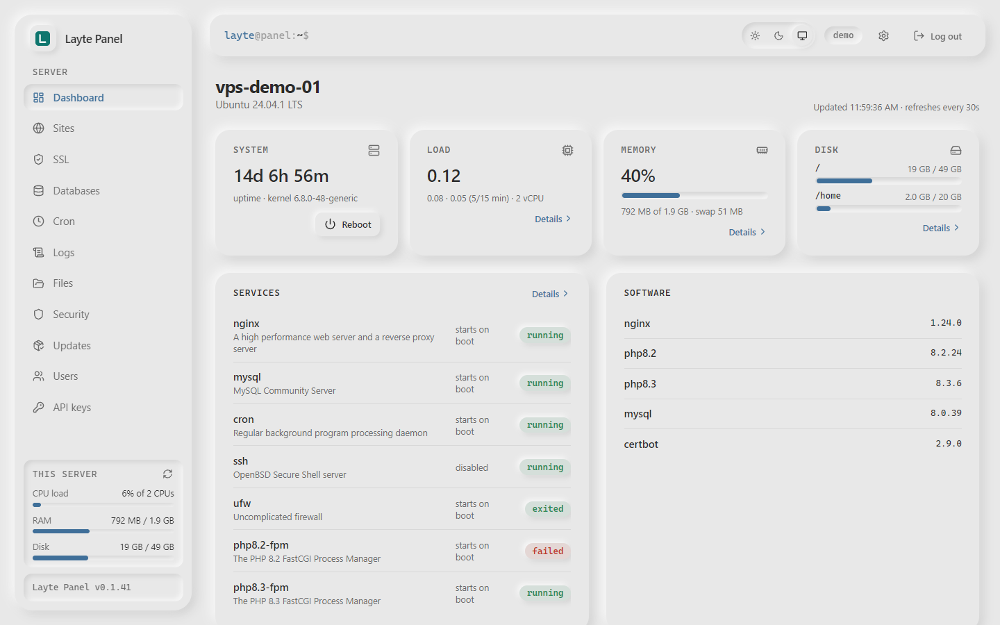
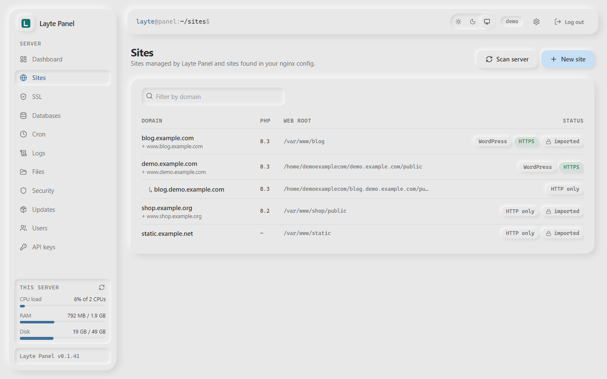
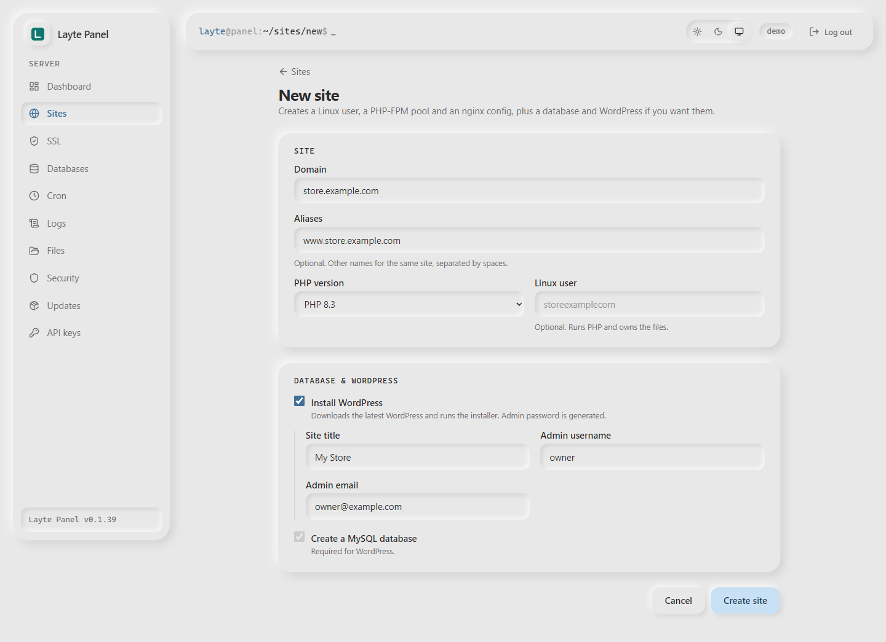
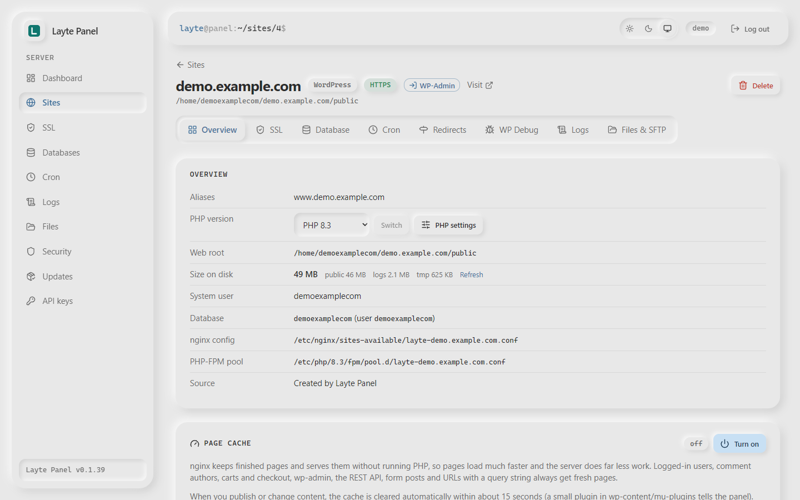
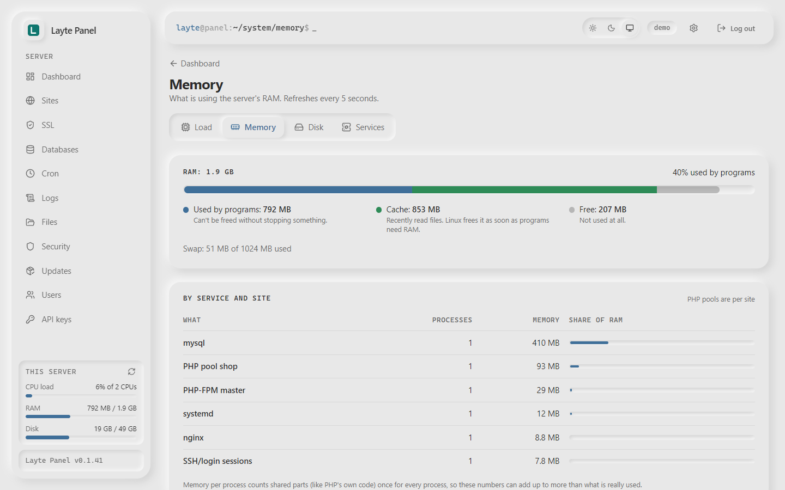
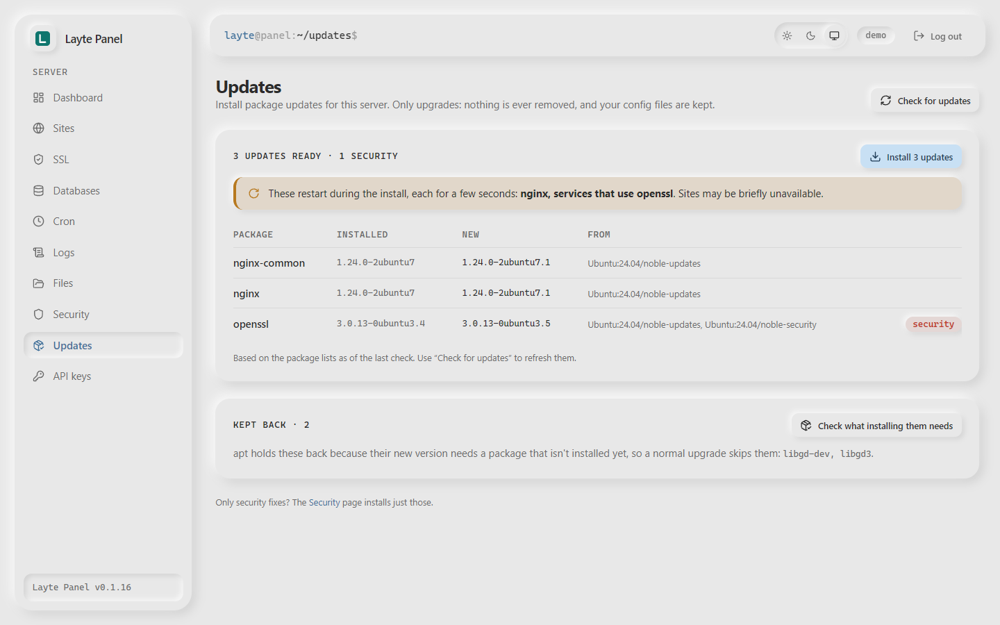
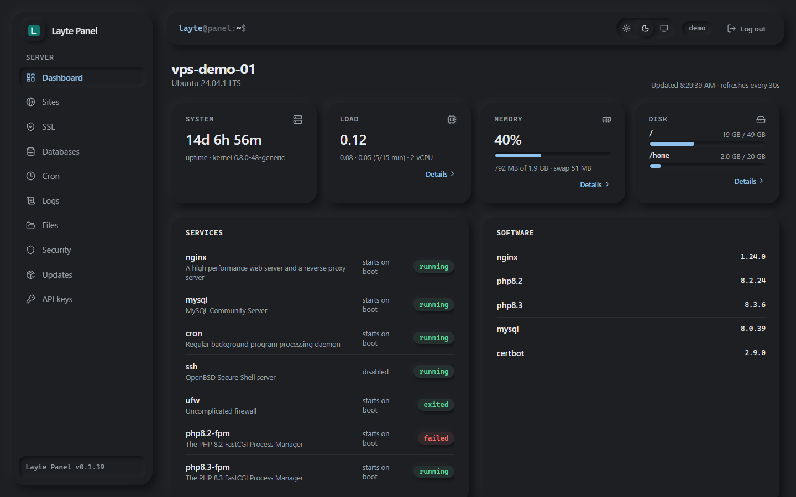

# Layte Panel

**A lightweight control panel for PHP and WordPress sites on an unmanaged VPS.** *By Web of D.*

Layte Panel is a self-hosted cPanel alternative for WordPress and PHP sites on your own Ubuntu server. It ships as one Go binary (about 12 MB) with the web UI built in, and uses about 15 MB of RAM, so it runs even on low-resource servers: 1 GB of RAM is the minimum.

📖 Read the story behind it: [I Built Layte Panel, a Lightweight Control Panel for Your VPS](https://blog.vincelayte.me/layte-panel-lightweight-vps-control-panel/), covering what it does, how it's built, and three bugs that only showed up on real servers.



## Features
- **Sites:**
  - Create sites in one step: Linux user, PHP-FPM pool, nginx vhost, MySQL/MariaDB database, and optionally WordPress via WP-CLI.
  - Switch PHP version per site without downtime.
  - Delete sites.
  - Existing sites are imported read-only, and can be **adopted**: they get their own Linux user and a Layte-managed PHP pool, while your nginx config stays yours (preview first, automatic rollback).
  - Optionally let Layte Panel manage an adopted site's nginx config too (diff first, files stay where they are) to unlock PHP switching, PHP settings and the page cache. Your original config is kept; the site's old certificate can be deleted once Layte's replaces it.
  - Redirects per site (old path → new page or another site, 301/302) on their own tab, with CSV import/export. They live in a separate file the site's nginx config includes, checked with `nginx -t` before they go live.
  - WordPress speed: a page cache (nginx FastCGI cache) and an object cache (Redis). Each site gets its own small Redis that only it can reach.
  - Size on disk per site.
- **SSL:** Let's Encrypt certificates via certbot, renewed automatically, with an expiry overview and certificate details. Test renewal or renew now from the panel.
- **Databases:** create, drop and see sizes. Export and import `.sql` dumps. Reset passwords (shown once); for WordPress sites `wp-config.php` is updated in the same step.
- **Cron:** per-site jobs that run as the site's own user, with WP-Cron in one click.
- **Logs:** live tail of nginx, PHP-FPM and site logs.
- **File manager:** browse, edit, upload and download. It always runs as the site's user, inside the site folder.
- **Site logins and subdomains:** give a site its own panel login (2FA required) that sees only that site and its subdomains, and can add subdomain sites up to a limit you set. See [docs/site-accounts.md](docs/site-accounts.md).
- **SFTP per site:** an SFTP-only login (SSH keys, optional generated password) jailed to the site's folder, working as the site's user, so FileZilla, VS Code or rsync keep files owned correctly. See [docs/sftp.md](docs/sftp.md).
- **Updates:** preview and install package updates. Only upgrades (nothing is removed), your config files are kept, every site is checked afterwards, and you're told when a reboot is needed.
- **Server insight:** see what uses the CPU and memory (per service and per site's PHP pool), and what takes up disk space.
- **Security:** ufw rules with lockout protection, security updates in one click, failed SSH logins.
- **API:** a read-only REST API with scoped, expiring API keys and an OpenAPI spec.
- **Safe by design:**
  - The web process has no privileges; a root helper runs only a fixed list of validated actions.
  - Every config change is tested (`nginx -t`) and rolled back on failure.
  - PHP-FPM reloads let running requests finish (up to 10 s) instead of cutting visitors off: Layte adds `pool.d/00-layte-graceful.conf` unless your `php-fpm.conf` sets `process_control_timeout` itself.
  - Configs it didn't create are never touched, unless you explicitly hand one over (it is kept as `.layte-orig`).
  - 2FA is mandatory.
  - See [docs/security.md](docs/security.md).

## Screenshots
| | |
|---|---|
|  Sites: created and imported |  New site: user, PHP pool, nginx, database and WordPress in one step |
|  A site's overview, with its own tabs |  What uses the memory, per service and site |
|  Updates: preview first, then install |  Dark mode |

*Demo data. The screenshots are generated with `cd web && npm run screenshots`.*

## Install
On a fresh or existing **Ubuntu 24.04 / 26.04** or **Debian 13** server:
```bash
curl -fsSL https://raw.githubusercontent.com/slightgrey/layte-panel/main/deploy/install.sh | sudo bash
```
See [docs/install.md](docs/install.md) for options: the panel domain, IP allowlist, unattended installs, and access over an SSH tunnel.

## Documentation
[Install](docs/install.md) · [Upgrade & backup](docs/upgrade.md) · [Security](docs/security.md) · [Troubleshooting](docs/troubleshooting.md) · [API](docs/api.md) · [Development](docs/development.md)

## Status
Early releases (0.x). Tested on Ubuntu 24.04 and 26.04 and Debian 13 (amd64) with nginx, PHP-FPM, and MySQL or MariaDB. Ubuntu 22.04 works but isn't recommended; see [supported systems](docs/install.md#supported-systems).

**Not included yet:** email hosting, DNS hosting, multiple servers, Docker apps.

## Development
```bash
go run ./cmd/layte agent --dev    # fake server data, never touches your machine
go run ./cmd/layte serve --dev
cd web && npm install && npm run dev
```
See [docs/development.md](docs/development.md).

## License
[AGPL-3.0](LICENSE). You can use, modify and self-host Layte Panel freely. If you offer a modified version to others as a service, you must publish your changes under the same license.
